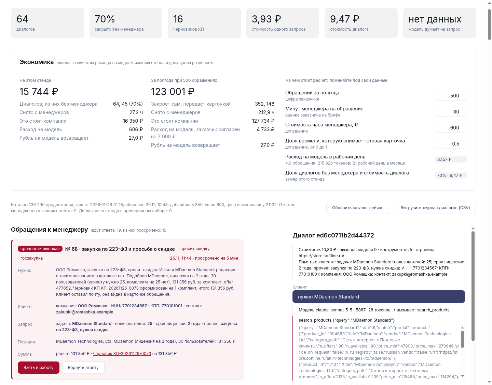

# ИИ-консультант Softline Store: питч

## На одной странице

**Проблема.** В переписках заказчика 495 обращений в чат магазина. 85,5% называют продукт, 42,4% спрашивают цену, 25,9% просят КП или счет, 9,5% не знают, что им нужно. Каждое такое обращение сегодня разбирает менеджер: находит лицензию среди 136 тыс. предложений, уточняет параметры, считает, оформляет. По словам заказчика на брифе, первого ответа клиент ждет в среднем 2 минуты, а обращение, где нужно искать и проверять по каталогу, занимает у менеджера порядка 30 минут.

**Решение.** Агент в чате сайта доводит клиента от вопроса до черновика КП и снимает с менеджера рутину, оставляя ему готовое обращение. Названный продукт он доводит до конкретной лицензии с артикулом и ценой, под задачу подбирает два варианта с обоснованием, по правилам магазина отвечает из справки. Скидку до 5% агент дает сам: это полномочие заказчик назвал на брифе. К менеджеру уходит то, что нельзя обслужить через магазин здесь и сейчас: скидка больше 5%, госзакупка, жалоба, цена по запросу, продукт вне каталога. Клиент может позвать менеджера и сам, кнопкой в чате. Обращение уходит карточкой, которую собирает код: срочность, срок реакции, клиент с реквизитами, запрос, позиции, сумма, черновик КП.

**Цифры.** Финальный прогон 26.11.2026: 63 диалога, 57 начинаются с реальных обращений из переписок заказчика. Все проверки прошли 57 диалогов (90%), без менеджера закрыты 45 (71%), цены только из каталога в 63 из 63, черновик КП сформирован во всех 7 диалогах, где его просили. Диалог стоит 9,45 руб. на Claude Sonnet 5.5: 500 обращений за полгода это около 4,7 тыс. руб., или 37 руб. в рабочий день (126 рабочих дней, около 4 обращений в день). Заказчик назвал приемлемыми 5-7 тыс. руб. за полгода.

**Объем работы.** Цель заказчик назвал на брифе: высвободить менеджеров на сложные случаи. Команда поддержки это 6-8 человек, кроме чата на них почта и общие ящики. 500 обращений в чат по 30 минут это 250 часов за полгода. По замеру прогона агент сам закрывает 71%: 357 обращений из 500, или 179 часов, которые менеджер не тратит совсем. Остальные 143 приходят готовой карточкой: клиент, реквизиты, позиции, сумма, КП. При допущении, что карточка снимает половину времени, это еще 36 часов. Вместе 214 часов из 250. У команды остается около 36 часов на то, где нужен человек: скидка больше 5%, госзакупка, жалоба, продукт вне каталога.

**Границы.** Цены только из каталога: сумму в ответе сверяет код, чужую сумму клиент не увидит. Суммы и НДС считает код. Скидка не больше 5%: потолок держит код, а не модель. Отсрочку и постоплату агент не обещает: в магазине их нет. Почта, телефон, ИНН и КПП клиента в модель не уходят. При любом сбое клиент получает ответ, а обращение уходит менеджеру.

**Переносимость.** Каталог, справка и инструменты развязаны. Каталог обновляется с фида магазина сам, раз в сутки, без остановки чата. Модель меняется настройкой: GigaChat, любой сервис с OpenAI-совместимым API или модель в своем контуре. Связь с CRM или 1С это еще один инструмент, цикл агента при этом не меняется.

**Что нужно для внедрения.** Ключ модели, адрес фида (уже подключен), ключи операторов. Заказчик задает сроки реакции по темам, потолок скидки агента и подставляет свои числа в экономику.

## Показ за 90 секунд

Все реплики проверены на цикле агента: этот диалог есть на экране оператора, обращение ООО Ромашка.

| Время | Что происходит | Что говорить |
|---|---|---|
| 0:00 | Чат. Клиент пишет пример из задачи: "нужен MDaemon Standard" | Агент не выдумывает редакцию: в каталоге Standard нет, он говорит это прямо, показывает, что есть, с ценами из каталога и задает один вопрос |
| 0:15 | "25 пользователей, новая лицензия, на 2 года" | Комплекта на 25 нет, агент предлагает ближайший на 30 за 131 356 руб. Под ответом видны шаги: какие инструменты вызваны, сколько токенов и рублей |
| 0:30 | "Подготовьте КП на ООО Ромашка, ИНН 7701234567, КПП 770101001" | Черновик КП по шаблону Softline за один ход. Сумму и НДС считает код, графа "Заказчик" заполнена реквизитами |
| 0:45 | "Закупка пойдет по 223-ФЗ, нужна скидка. Почта для связи: ..." | Госзакупка по правилу заказчика это сложный случай: агент передает обращение менеджеру и условий не обещает. Почту модель не видела: в обращение ее подставил код |
| 0:55 | Экран оператора, карточка обращения | Менеджер не читает переписку. Срочность высокая, срок реакции 2 минуты, пометки "госзакупка" и "просит скидку", клиент с реквизитами, позиция, сумма, КП. Взять в работу или вернуть агенту |
| 1:05 | Тот же экран, блок экономики | Семь диалогов из десяти закрыты без менеджера, диалог стоит около 9 рублей. По оценке заказчика на обращение уходит 30 минут менеджера: 500 обращений за полгода это 250 часов. Агент снимает из них около 210: большую часть закрывает сам, остальное отдает менеджеру готовой карточкой. Эти часы возвращаются команде из 6-8 человек, на которой еще почта и общие ящики. Стоимость часа и польза карточки это допущения, они подписаны и меняются прямо здесь. Ниже расход на модель в день: 215 тыс. токенов, 37 рублей |
| 1:15 | Страница "Проверка цен" | Модель называет выдуманную "специальную цену". Код ловит сумму, которой нет в каталоге: сначала возвращает ответ модели, а если она настаивает, вырезает сумму сам |
| 1:25 | Экран оператора, кнопка "В проверочный набор" | 181 тест и 63 проверочных диалога. Диалог, где агент ошибся, одной кнопкой становится проверкой для следующего прогона |

## Вопросы жюри

**А если модель соврет с ценой?** Не дойдет до клиента. Каждая сумма в ответе сверяется кодом с данными каталога в этом диалоге. На странице `/proof` это видно на живом цикле агента, в тестах это `tests/test_loop.py`. В финальном прогоне проверка сработала один раз: агент сам посчитал разницу между двумя ценами, код вернул ответ на переписывание, и клиент этой суммы не увидел. Цены в ответах клиентам взяты из каталога в 63 диалогах из 63.

**А скидки?** До 5% агент дает сам: так заказчик решил на брифе. Потолок держит код: в расчете и в КП скидка не станет больше 5%, сколько бы ни просил клиент и что бы ни передала модель. В КП скидка стоит отдельными строками: сумма без скидки, скидка, итог. Больше 5%, отсрочка и постоплата уходят менеджеру с пометкой "просит скидку". В наборе это отдельный диалог: клиент просит отсрочку, потом скидку, потом 15%.

**Как клиент попадает к человеку?** Двумя путями. Агент передает обращение сам, когда случай нельзя обслужить через магазин: госзакупка, продукт вне каталога, цена по запросу, жалоба. Или клиент нажимает "Позвать менеджера": обращение заводит код, модель для этого не вызывается. Ответ менеджера клиент видит в том же чате.

**Интеграция с CRM и 1С?** Заказчик ответил, что на хакатоне она не нужна. В решении единственная точка связи с внешними системами это инструменты: новая система добавляется одним инструментом.

**Почему нет векторного поиска?** Клиенты называют продукт в 85% обращений, часто с опечатками и разговорно: "кес", "ксп", "астра орел". Артикулы и опечатки точнее ловит полнотекстовый поиск с триграммами и транслитом. Смысловой подбор ("защитить почту") делает модель через категории каталога.

**Сколько стоит?** 9,45 руб. за диалог и 3,97 руб. за реплику на Claude Sonnet 5.5 по замеру прогона. На 500 обращений за полгода это около 4,7 тыс. руб.; заказчик подтвердил, что 5-7 тыс. руб. его устраивает. В рабочий день это около 4 обращений, 215 тыс. токенов и 37 руб.: полгода считаются как 126 рабочих дней. Расчет по другим моделям есть в README.

**Насколько быстро отвечает агент?** Не измерено: прогоны шли через мост разработки, времени ответа модели в них нет. На реплику агент делает в среднем три обращения к модели. Заказчик назвал целью быструю реакцию (сейчас первый ответ менеджера приходит в среднем через 2 минуты), поэтому замер на боевой модели это первый шаг после подключения ключа.

**Почему Claude, а не российская модель?** Заказчик требований к модели не ставит. Прогоны шли на Claude Sonnet 5.5 через мост разработки. Модель меняется настройкой, готовы подключения GigaChat и любого OpenAI-совместимого сервиса; на них набор не прогонялся, это первый шаг после хакатона.

**В чем выгода для заказчика?** В объеме работы, который агент снимает с команды. Заказчик на брифе назвал цель так: высвободить менеджеров на более сложные случаи. Из 250 часов, которые чат забирает за полгода, агент снимает около 210, а оставшееся время идет на скидки сверх 5%, госзакупки и жалобы. Штат остается прежним: те же 6-8 человек ведут почту и общие ящики, туда и уходят освободившиеся часы. Второй эффект проверяется на пилоте: клиент получает ответ и черновик КП сразу, без ожидания менеджера, поэтому до КП должно доходить больше диалогов. В прогоне КП сформирован во всех 7 диалогах, где его просили; на живом трафике доля диалогов с КП не измерялась.

**Откуда цифры экономики?** Доля диалогов без менеджера и стоимость диалога измерены прогоном. Минуты менеджера на обращение это оценка заказчика на брифе: порядка 30 минут там, где нужно искать и проверять по каталогу. Стоимость часа менеджера и польза карточки это допущения. Все три числа подписаны на экране, заказчик подставляет свои.

**Что с персональными данными?** Заказчик на брифе назвал условие: при зарубежной облачной модели персональные данные клиентов туда передавать нельзя. Почта, телефон, ИНН и КПП заменяются метками до отправки в модель, настоящие значения код сам кладет в обращение и в КП, их видит только менеджер. Фамилию в свободном тексте код надежно не вырежет, поэтому для боевого контура модель ставится российская или в своем контуре: это одна настройка. Без ключа оператора экран открыт на чтение, контакты и реквизиты скрыты. Журнал хранится 90 дней.

**Что будет, когда магазин изменит фид?** Уже было в спринте: живой фид оказался размечен иначе, чем файл из материалов. Сборка читает обе разметки, а сторож отменяет подмену базы, если параметры лицензий стали читаться хуже: чат продолжает работать по вчерашнему каталогу, причина видна оператору.

**Что не прошло в прогоне?** Шесть диалогов из 63. В четырех агент ответил или передал обращение сразу, без уточняющего вопроса, которого ждал набор; в одном из них вопрос был лишним, клиент назвал все сам. В одном агент не завел обращение менеджеру по вопросу об оплате картой физлица за организацию: это известное ограничение. В одном ошиблась сама проверка: не узнала название продукта, написанное кириллицей. Разбор каждого диалога есть в README.

**Что не сделано?** Счет агент не формирует: счет-оферту клиент получает сам при заказе на сайте, агент рассказывает как. Остатков и сроков поставки в фиде нет. Вход оператора сейчас по одному ключу. Уведомления менеджеру в мессенджер нет: обращения приходят на экран оператора. Время ответа на боевой модели не измерялось.
